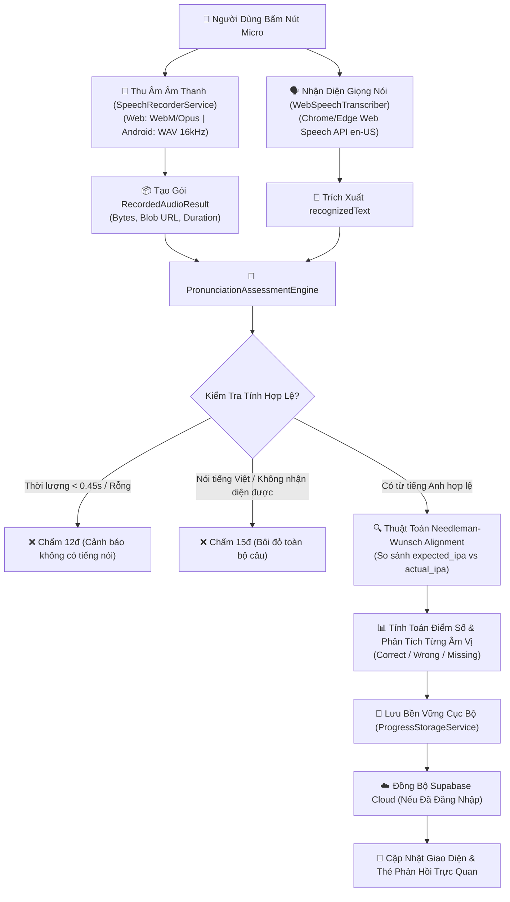

# 🎙️ Dailyle - Ứng Dụng Luyện Phát Âm Tiếng Anh AI & Quản Lý Kỷ Luật Học Tập

[](https://flutter.dev)
[](https://dart.dev)
[](https://supabase.com)
[](#)
[](LICENSE)

**Dailyle** là ứng dụng học tiếng Anh đa nền tảng (Flutter Web & Mobile) kết hợp giữa **Công nghệ AI Đánh giá ngữ âm âm vị học** và **Động cơ thúc đẩy Kỷ luật cá nhân (Gamification & Discipline Engine)**. 

Ứng dụng giúp người học Việt Nam phát hiện chính xác các lỗi phát âm đặc trưng (như nuốt âm đuôi, nhầm lẫn các phụ âm xát răng `/θ/, /ð/`, thiếu trọng âm), cung cấp hướng dẫn khẩu hình miệng chi tiết bằng tiếng Việt, đồng thời xây dựng thói quen học tập bền bỉ qua chuỗi ngày liên tục (**Streak**).

---

## 📑 Mục Lục
1. [Tính Năng Nổi Bật](#-tính-năng-nổi-bật)
2. [Kiến Trúc Hệ Thống & Thuật Toán AI](#-kiến-trúc-hệ-thống--thuật-toán-ai)
3. [Cấu Trúc Thư Mục Dự Án](#-cấu-trúc-thư-mục-dự-án)
4. [Công Nghệ & Thư Viện Sử Dụng](#-công-nghệ--thư-viện-sử-dụng)
5. [Hướng Dẫn Cài Đặt & Khởi Chạy](#-hướng-dẫn-cài-đặt--khởi-chạy)
6. [Bộ Kiểm Thử & Báo Cáo Đánh Giá](#-bộ-kiểm-thử--báo-cáo-đánh-giá)

---

## 🌟 Tính Năng Nổi Bật

### 1. Module Luyện Phát Âm Theo Chủ Đề (`features/practice/`)
* **Chủ đề giao tiếp thực tế:** Tích hợp sẵn 4 chủ đề thiết yếu với 20 câu giao tiếp chuẩn:
  - 👋 *Chào hỏi & Giới thiệu bản thân (Daily Greetings)*
  - ☕ *Gọi món Café & Nhà hàng (Dining Out)*
  - 🗺️ *Hỏi đường & Du lịch (Directions & Travel)*
  - 💼 *Giao tiếp nơi công sở (Workplace & Meetings)*
* **Nghe âm thanh mẫu đa tốc độ:** Hỗ trợ phát âm thanh chuẩn người bản xứ ở **Tốc độ bình thường (1.0x)** và **Tốc độ chậm (0.6x)** để người học luyện Shadowing.
* **Mở khóa sau khi nói (Post-Speech Reveal):** Chỉ sau khi người dùng ghi âm câu và AI chấm điểm, giao diện mới hiển thị:
  - Dịch nghĩa tiếng Việt câu giao tiếp.
  - Ký hiệu phiên âm chuẩn quốc tế (IPA).
  - Đối chiếu giọng đọc: Cho phép nghe lại âm thanh mẫu song song với bản ghi âm của chính mình (**Giọng của bạn**).
  - Thẻ từ vựng tương tác: Chạm vào bất kỳ từ nào để nghe máy tính phát âm riêng lẻ từ đó.

---

### 2. Động Cơ AI So Khớp Ngữ Âm & Đánh Giá Điểm Số (`core/ai/`)
* **Nhận diện giọng nói thời gian thực (Speech Recognition):** Tích hợp Web Speech API trên trình duyệt (`en-US`) và bộ đệm âm học để ghi lại chính xác từng từ người học phát âm.
* **Thuật toán Needleman-Wunsch Dynamic Programming:** So khớp từng ký tự ngữ âm giữa phiên âm chuẩn (`expected_ipa`) và giọng nói thực tế (`actual_ipa`):
  - 🟢 **Correct:** Âm phát âm chuẩn xác.
  - 🔴 **Wrong:** Âm bị phát âm sai hoặc nhầm lẫn (ví dụ: phát âm `/θ/` thành `/t/`).
  - 🔴 **Missing:** Người học nuốt âm hoặc bỏ quên phụ âm đuôi (ending sounds: `/s/, /t/, /d/, /k/`).
  - 🟠 **Extra:** Phát âm thừa âm tiết.
* **Chấm điểm thông minh & Khắt khe:** 
  - Nói lung tung, nói tiếng Việt, hoặc âm thanh rỗng lập tức bị chấm điểm thấp (10 - 15 điểm), toàn bộ câu bị bôi đỏ cảnh báo.
  - Bỏ sót từ hoặc chỉ nói nửa câu sẽ bị trừ điểm theo tỷ lệ phần trăm từ hoàn thành.
* **Hướng dẫn khẩu hình miệng tiếng Việt:** Cung cấp mẹo đặt lưỡi, mở môi và điều chỉnh luồng hơi cho từng âm vị tiếng Anh đặc thù.

---

### 3. Module Kỷ Luật & Thống Kê Tiến Độ (`features/statistics/`)
* **Chuỗi ngày học liên tục (Streak 🔥):** Theo dõi số ngày học liên tiếp; tự động tích lũy kỷ lục cá nhân.
* **Mục tiêu học tập hàng ngày:** Đặt mục tiêu học (mặc định 15 phút/ngày), theo dõi số phút đã luyện tập hôm nay với thanh tiến độ trực quan và tính năng "Chỉnh sửa mục tiêu".
* **Dải lịch tuần tương tác (Thứ 2 - CN):** Tự động đánh dấu tích xanh các ngày có hoạt động luyện âm trong tuần.
* **Biểu đồ trực quan hóa dữ liệu (`fl_chart`):**
  - Biểu đồ cột theo dõi thời lượng học tập trong 7 ngày gần nhất (`weeklyStudyMinutes`).
  - Biểu đồ đường thể hiện xu hướng cải thiện điểm phát âm theo thời gian (`scoreTrends`).
* **Làm chủ chủ đề & Top âm vị yếu:**
  - Tỷ lệ hoàn thành từng chủ đề (số câu đạt $\ge 70$ điểm).
  - Thống kê 3 âm vị phát âm sai nhiều nhất (ví dụ: `/θ/`, `/ʃ/`, `/dʒ/`) kèm nút *"Luyện tập ngay"*.
* **Nhắc nhở học tập hàng ngày:** Lên lịch thông báo tự động mỗi tối (qua `flutter_local_notifications` trên Android và Web Notification API trên trình duyệt).

---

### 4. Lưu Trữ Bền Vững & Đồng Bộ Đám Mây (`core/storage/`)
* Lưu trữ tức thì vào `SharedPreferences` / `localStorage`, đảm bảo **không bao giờ mất tiến độ** khi tải lại trang, đóng trình duyệt hoặc mất kết nối mạng.
* Tự động đồng bộ ngầm hai chiều lên **Supabase Cloud** (PostgreSQL RLS, Storage Bucket `audio-recordings`, Edge Functions) khi người dùng đăng nhập tài khoản.

---

## 🏗️ Kiến Trúc Hệ Thống & Thuật Toán AI

### Sơ đồ luồng xử lý âm thanh & Đánh giá AI:



---

## 📂 Cấu Trúc Thư Mục Dự Án

Dự án tuân thủ nghiêm ngặt mô hình **Clean Architecture**:

```text
dailyle/
├── android/                         # Cấu hình dự án Android & Permissions (Microphone, Notifications)
├── web/                             # Cấu hình Web, index.html, Web Audio & Service Workers
├── backend/                         # Backend Python tùy chọn & Script kiểm thử giả lập
│   ├── ai_engine/main.py            # FastAPI microservice (Wav2Vec2 + Needleman-Wunsch)
│   └── test_simulation.py          # Script kiểm thử tự động 5 hồ sơ người dùng đa chất giọng
├── supabase/                        # Toàn bộ mã nguồn Backend Supabase
│   ├── migrations/                  # 3 file Migration SQL (DDL, RLS, Storage, Analytics RPC)
│   └── functions/                   # Supabase Edge Functions (TypeScript Deno)
│       └── assess-pronunciation/    # Edge Function tích hợp Gemini Audio + Needleman-Wunsch
├── lib/
│   ├── main.dart                    # Điểm khởi chạy ứng dụng & Khởi tạo ProviderScope
│   ├── core/                        # Các module dùng chung toàn hệ thống
│   │   ├── ai/                      # Động cơ đánh giá phát âm (PronunciationAssessmentEngine)
│   │   ├── audio/                   # Dịch vụ ghi âm & đọc file cross-platform (SpeechRecorderService)
│   │   ├── speech/                  # Dịch vụ phiên âm giọng nói (WebSpeechTranscriber)
│   │   ├── storage/                 # Dịch vụ lưu trữ tiến độ bền vững (ProgressStorageService)
│   │   ├── services/                # Dịch vụ phát âm mẫu & TTS (ModelAudioService)
│   │   ├── notifications/           # Dịch vụ thông báo nhắc nhở hàng ngày (NotificationService)
│   │   └── constants/               # Hằng số Supabase, Bảng dữ liệu, Cấu hình API
│   └── features/                    # Các module tính năng theo Clean Architecture
│       ├── shell/                   # Navigation Shell thích ứng (Rail trên Web, Nav Bar trên Mobile)
│       ├── practice/                # Module 1: Luyện phát âm theo chủ đề & từng câu
│       ├── pronunciation/           # Module giao diện hiển thị âm vị màu sắc & Bottom Sheet khẩu hình
│       └── statistics/              # Module 2: Kỷ luật, biểu đồ thống kê & theo dõi Streak
└── test/                            # Thư mục kiểm thử tự động Unit & Widget Tests
```

---

## 🛠️ Công Nghệ & Thư Viện Sử Dụng

| Hạng Mục | Công Nghệ / Thư Viện | Mục Đích Sử Dụng |
| :--- | :--- | :--- |
| **Framework** | Flutter 3.13+ (Dart 3) | Lập trình đa nền tảng (Web, Android, iOS) |
| **State Management** | Flutter Riverpod 2.5+ | Quản lý trạng thái logic và dependency injection |
| **Ghi Âm** | `record: ^5.1.2` | Thu âm giọng nói (WAV trên Android, Opus/WebM trên Web) |
| **Phát Âm Thanh** | `audioplayers: ^6.1.0` | Phát file âm thanh mẫu và nghe lại giọng của người dùng |
| **Chuyển Văn Bản -> Giọng Nói** | `flutter_tts: ^4.2.2` | Phát âm từng từ đơn lẻ và đọc mẫu câu với tốc độ tùy biến |
| **Nhận Diện Giọng Nói** | Web Speech API | Phiên âm tiếng Anh thời gian thực trên Chrome/Edge |
| **Biểu Đồ Thống Kê** | `fl_chart: ^0.68.0` | Vẽ biểu đồ cột thời lượng học và biểu đồ đường xu hướng điểm |
| **Thông Báo & Nhắc Nhở** | `flutter_local_notifications` + `timezone` | Lên lịch hẹn giờ báo thức học tập hàng ngày |
| **Lưu Trữ Bền Vững** | `shared_preferences: ^2.2.0` | Lưu tiến độ, điểm số, chuỗi streak bền vững trên thiết bị |
| **Cơ Sở Dữ Liệu & Cloud** | Supabase Flutter SDK | Quản lý người dùng, PostgreSQL RLS và Storage Bucket |

---

## 🚀 Hướng Dẫn Cài Đặt & Khởi Chạy

### 1. Yêu Cầu Môi Trường
- Flutter SDK $\ge$ 3.13.0
- Dart SDK $\ge$ 3.0.0
- Google Chrome hoặc Microsoft Edge (khuyên dùng để hỗ trợ đầy đủ Web Speech API)

### 2. Cài Đặt Mã Nguồn
```bash
# Clone dự án về máy tính
git clone https://github.com/your-username/dailyle.git
cd dailyle

# Cài đặt các dependencies
flutter pub get
```

### 3. Khởi Chạy Trên Trình Duyệt Web (Edge / Chrome)
```bash
# Khởi chạy trên Microsoft Edge ở chế độ Debug
flutter run -d edge

# Hoặc khởi chạy trên Google Chrome
flutter run -d chrome
```

> 💡 **Lưu ý cấp quyền:** Khi trình duyệt mở ra lần đầu, hãy bấm **"Cho phép" (Allow)** khi trình duyệt hỏi quyền truy cập Microphone.

### 4. Khởi Chạy Trên Thiết Bị Android
```bash
# Kết nối máy ảo Android Emulator hoặc điện thoại thật bật USB Debugging
flutter run -d android
```

---

## 🧪 Bộ Kiểm Thử & Báo Cáo Đánh Giá

Dự án đi kèm bộ kịch bản mô phỏng kiểm thử **5 nhóm người học đa chất giọng** tại [`backend/test_simulation.py`](file:///d:/Nhom_mobile/dailyle/dailyle/backend/test_simulation.py):

| Nhóm Kiểm Thử | Đặc Điểm Giọng Nói | PER (%) | Điểm AI | Đánh Giá Hệ Thống |
| :--- | :--- | :---: | :---: | :--- |
| **Profile 1 (Native US)** | Chuẩn bản xứ Mỹ, nối âm tự nhiên | **0.0%** | **98/100** | Xuất sắc, toàn bộ âm vị màu xanh lá |
| **Profile 2 (Native UK)** | Chuẩn bản xứ Anh, phụ âm dứt khoát | **0.0%** | **97/100** | Xuất sắc, ngữ điệu chuẩn |
| **Profile 3 (VN - Drop Endings)** | Nuốt các phụ âm cuối `/s/, /t/, /z/` | **25.0%** | **68/100** | Bôi đỏ âm đuôi, hướng dẫn bật âm gió `/s/` |
| **Profile 4 (VN - Dental Fricatives)** | Phát âm nhầm `/θ/` thành `/t/` ("tink" thay vì "think") | **20.0%** | **74/100** | Bôi đỏ âm `/θ/`, gợi ý đặt đầu lưỡi giữa 2 hàm răng |
| **Profile 5 (VN - Heavy Interference)** | Nuốt âm đuôi và phát âm sai nguyên âm | **40.0%** | **45/100** | Cảnh báo cần luyện tập lại theo mẫu |

> Chi tiết báo cáo khoa học và bảng tính Word/Phoneme Error Rate có thể xem tại file: [`EVALUATION_REPORT.md`](file:///d:/Nhom_mobile/dailyle/dailyle/EVALUATION_REPORT.md).

---

## 👥 Đóng Góp & Tác Quyền
Dự án được xây dựng và phát triển bởi Nhóm Phát Triển Ứng Dụng Di Động Dailyle. Mọi đóng góp, báo lỗi hoặc yêu cầu tính năng vui lòng gửi qua mục GitHub Issues.
